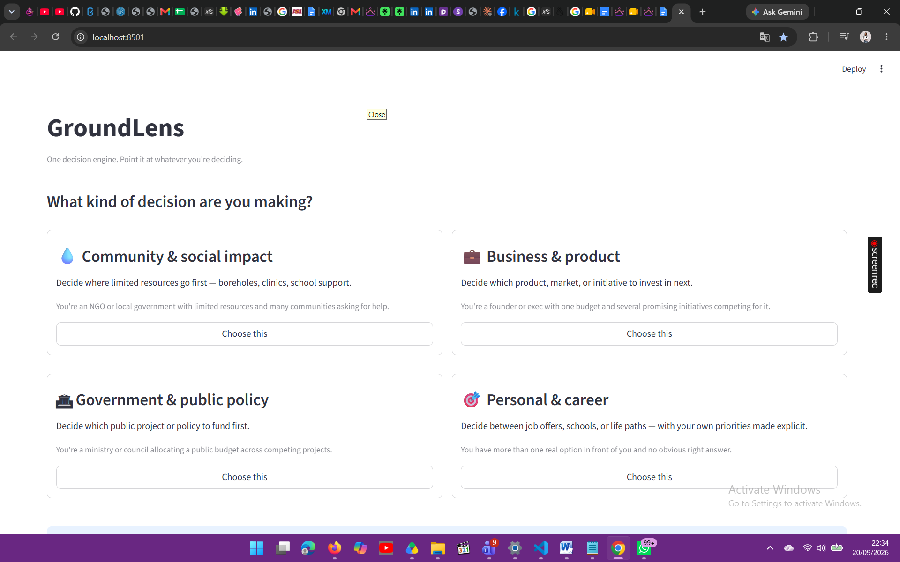
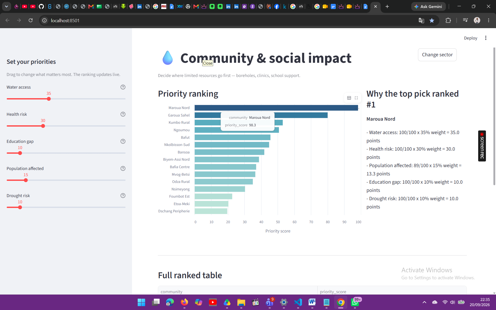
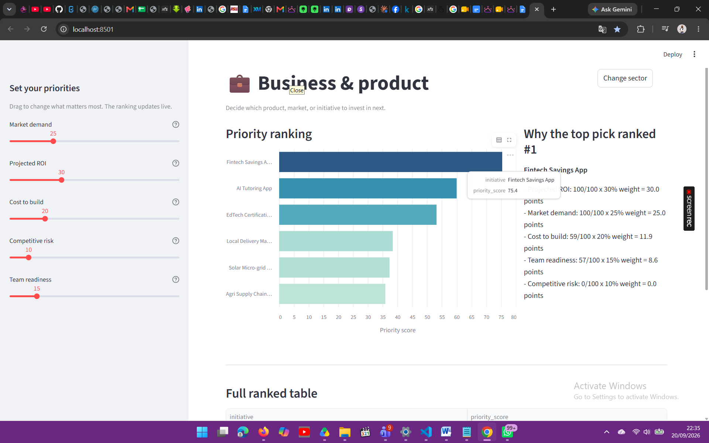

# GroundLens

**One decision engine. Point it at whatever you're deciding.**

GroundLens is a multi-sector decision-support platform that ranks options by a transparent, adjustable priority score — so a stakeholder can see, live, what should come first, and exactly *why*. Built by **MATRIX GIRLS** as a capstone project for EmpowerHer Tech Foundation's Coding for Kids program, and presented at LAND Association's FOJEF 2 (Young Girls' Forum).

> Before each decision, the user is asked one question — *what kind of decision are you making?* — and the engine reconfigures itself around the answer: different data, different factors, different framing. Same brain, four different worlds.

---

## Table of contents

- [Why GroundLens](#why-groundlens)
- [Screenshots](#screenshots)
- [How it works](#how-it-works)
- [Sectors included](#sectors-included)
- [Getting started](#getting-started)
- [Project structure](#project-structure)
- [Adding a new sector](#adding-a-new-sector)
- [Tech stack](#tech-stack)
- [Roadmap](#roadmap)
- [Team](#team)
- [Acknowledgments](#acknowledgments)
- [License](#license)

---

## Why GroundLens

Big decisions — where to place a borehole, which product to fund, which public project to prioritize, which job offer to take — are too often made on intuition, politics, or guesswork, because the people making them don't have a reliable way to compare their options against the real factors that matter.

GroundLens fixes that with a simple, explainable technique: **multi-criteria decision analysis (MCDA)**, the same method used in real policy planning. Every option is scored against the factors that matter, the weights are fully visible and adjustable, and every ranking comes with a plain-language explanation — no black box.

## Screenshots

**Pick a decision.** The engine reconfigures itself around four different sectors.



**Community & social impact.** Live priority ranking with adjustable weights and an explanation of the top result.



**Business & product.** Same engine, completely different data and factors.



## How it works

1. **Ground data** — real indicators per option (water access, health risk, population, cost, ROI, urgency... whatever the sector needs).
2. **Weighted scoring** — every factor is normalized to a 0–100 scale and combined using stakeholder-set weights. Weights are adjustable live via sliders.
3. **Ranked + explained** — options are sorted by priority score, with a plain-language breakdown of exactly why each one landed where it did.

```python
from decision_engine import rank_from_sector
from sectors import SECTORS

ranked, weights = rank_from_sector(SECTORS["community"])
print(ranked[["rank", "community", "priority_score"]])
```

## Sectors included

| Sector | What it ranks | Example factors |
|---|---|---|
| **Community & social impact** | Communities competing for limited resources | Water access, health risk, education gap, population, drought risk |
| **Business & product** | Product or initiative bets | Market demand, projected ROI, cost to build, competitive risk, team readiness |
| **Government & public policy** | Public projects competing for budget | Population impact, cost, urgency, political feasibility, long-term ROI |
| **Personal & career** | Job offers, schools, or life paths | Salary, growth potential, work-life balance, location fit, mission alignment |

Each sector is fully self-contained in [`sectors.py`](sectors.py) — new sectors can be added without touching the scoring engine or the dashboard.

## Getting started

### Requirements

- Python 3.9+

### Installation

```bash
git clone https://github.com/<your-username>/groundlens.git
cd groundlens
pip install -r requirements.txt
```

### Run the dashboard

```bash
streamlit run app.py
```

This opens the live dashboard in your browser. Pick a sector, then drag any slider to watch the ranking update in real time.

### Run the engine standalone (no UI)

```bash
python3 decision_engine.py
```

Prints a ranked table for the community sector in your terminal, plus a plain-language explanation of the top result.

## Project structure

```
groundlens/
├── app.py                  # Streamlit dashboard — sector picker + live ranking
├── decision_engine.py      # Core scoring logic (sector-agnostic)
├── sectors.py              # Sector registry — data, factors, wording per sector
├── requirements.txt
├── data/
│   ├── communities.csv
│   ├── business_options.csv
│   ├── policy_projects.csv
│   └── career_options.csv
└── screenshots/
```

## Adding a new sector

1. Add a CSV under `data/` with one row per option and one column per factor.
2. Add an entry to `SECTORS` in `sectors.py`:

```python
"my_sector": {
    "label": "My New Sector",
    "icon": "\U0001F3AF",
    "tagline": "One line describing the decision.",
    "user_line": "One line describing who's using this.",
    "data_path": "data/my_data.csv",
    "name_col": "option_name",
    "entity_label": "option",
    "factors": {
        "my_factor": {
            "column": "my_csv_column",
            "direction": "higher_priority",  # or "lower_priority"
            "label": "My Factor",
            "help": "One line explaining the factor.",
            "default_weight": 25,
        },
        # ...more factors
    },
},
```

That's it — the new sector appears automatically on the picker screen, with sliders and charts built from the config. No changes needed in `app.py` or `decision_engine.py`.

## Tech stack

- **Python** — core scoring logic (pandas)
- **Streamlit** — live interactive dashboard
- **Altair** — charts

## Roadmap

- [ ] Pilot with a real NGO or local program using real ground data
- [ ] Add a lightweight risk-prediction model (e.g. drought/outbreak risk)
- [ ] Package as a platform other organizations can plug their own data into

## Team

Built by **MATRIX GIRLS**:

- Odupute Princess Clare Adaoma
- Wanyaka Andele Eden Gloria
- Amaka Sarah Precious Okechuku Ikoe
- Djiyo Sydney

## Acknowledgments

- **EmpowerHer Tech Foundation** — Coding for Kids program
- **LAND Association** — FOJEF 2, Forum des Jeunes Filles

## License

Add a license of your choice (e.g. MIT) before making this repository public.
